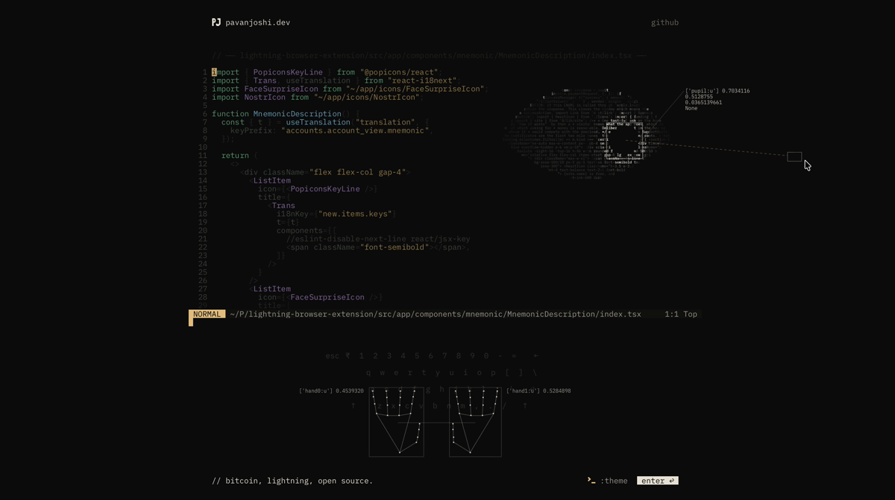
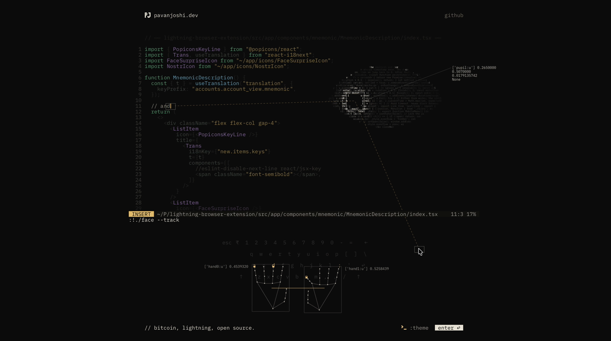
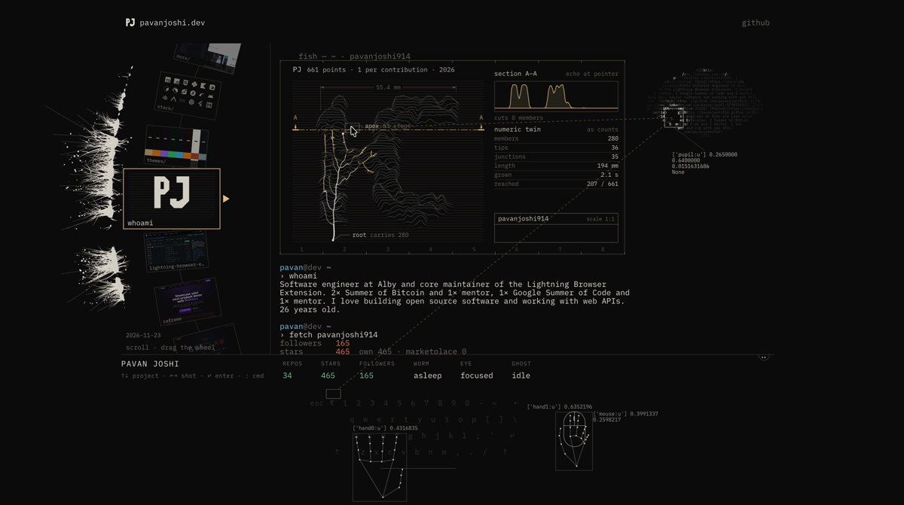
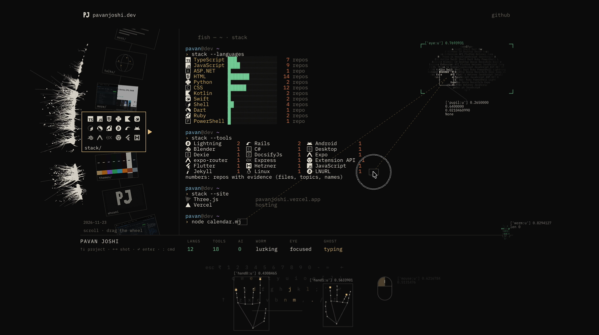

# Midhun Krishnan B

Python and Generative AI developer. This repository is the source of my portfolio: a dark, editor-style site with an animated code wall, a terminal for projects and experience, and keyboard navigation.

**Live site:** [midhunkrishnan-131.github.io/github-portfolio](https://midhunkrishnan-131.github.io/github-portfolio/)

[](https://midhunkrishnan-131.github.io/github-portfolio/)
[](https://github.com/midhunkrishnan-131)
[](mailto:midhunmaddy84@gmail.com)
[](https://www.linkedin.com/in/midhun-krishnan-342084436/)

<p align="center">
  <a href="https://midhunkrishnan-131.github.io/github-portfolio/">
    
  </a>
</p>

## About

I am a BCA Computer Science student at Yenepoya (Deemed to be University), online programme, expected graduation 2028. I build practical projects around Python, REST APIs, and LLM integration: structured outputs, tool calling, streaming, retries, and pagination. I also have IT and technical support experience.

I am based in Thiruvananthapuram, Kerala, India. I speak Malayalam (native), Tamil (fluent), and English (conversational).

I am open to Python and Generative AI internships. I do not present unfinished work as a production product.

## What the site does

The site is a static HTML, CSS, and JavaScript app. There is no framework and no build step for local preview.

1. **Intro.** A full-screen wall of code from my repositories, with a status line, a `:theme` switcher, and an Enter control that opens the portfolio.
2. **Editor.** A Neovim-like workspace. The left side is a project wheel. The right side is a terminal buffer for the selected section.
3. **Sections.** About, featured projects, work and education, the LCAT certificate, smaller repositories, the language and tool stack, and color themes.
4. **Phone layout.** Below 700px the wheel becomes a project menu. On short screens the decorative desk is hidden so the editor stays on screen.

| Intro | Editor |
| :---: | :---: |
|  |  |
| **Projects** | **Themes** |
|  |  |

A short recording is in [`dev-portfolio-template-main/assets/demo.mp4`](dev-portfolio-template-main/assets/demo.mp4).

## How to use it

On a laptop, with a pointer:

| Action | What it does |
| --- | --- |
| `Enter` on the intro | Opens the editor |
| `j` / `k` or the scroll wheel | Moves through projects and sections |
| `:theme` | Opens the color-scheme picker |
| Click a link in the buffer | Opens the GitHub repository, email, or certificate |

On a phone, tap `~/Projects` to open the section list, then tap an item.

## Featured work

These are the projects the editor lists first. Descriptions match the repositories. Work that is still in progress is labeled that way on the site.

| Project | What it is | Repository |
| --- | --- | --- |
| LUMO | AI search and research platform under active development. FastAPI and JavaScript. Keyword, semantic, hybrid, and AI-assisted search are documented in the repo, not shipped as a finished product. | [lumo-search-platform](https://github.com/midhunkrishnan-131/lumo-search-platform) |
| MYX AI | Development project for an AI-assisted Windows security assessment workspace. React, TypeScript, FastAPI, PostgreSQL. Not all parts are implemented. | [myx-ai-windows](https://github.com/midhunkrishnan-131/myx-ai-windows) |
| CodeDoctor AI | AI-assisted Python debugging with a complete-answer mode, a Socratic hint mode, and isolated execution. | [CodeDoctor--AI](https://github.com/midhunkrishnan-131/CodeDoctor--AI) |
| Multimodal Benchmark | Experiments for image understanding, speech, latency, and an STT-to-LLM-to-TTS pipeline. | [multi_model](https://github.com/midhunkrishnan-131/multi_model) |
| DevAssist | CLI LLM client with multi-turn chat, streaming, retries, and validated tool calls. | [LLM-cli-client](https://github.com/midhunkrishnan-131/LLM-cli-client) |
| API Client | Reusable REST client with session reuse, retries, structured logging, and generator-based pagination. | [api-client-project](https://github.com/midhunkrishnan-131/api-client-project) |

Smaller repositories in the `more/` section: [Invoice Extractor](https://github.com/midhunkrishnan-131/invoice-extractor), [Chart Honesty Lab](https://github.com/midhunkrishnan-131/chart-honesty-lab), [Data Cleaning](https://github.com/midhunkrishnan-131/Data-cleaning-), [Weather CLI](https://github.com/midhunkrishnan-131/weather-cli), [File Organizer](https://github.com/midhunkrishnan-131/file_organizer), and [NumPy Vectorisation](https://github.com/midhunkrishnan-131/numpy_vectorisation_assignment).

## Experience and education

| When | Role | Where |
| --- | --- | --- |
| Expected 2028 | BCA, Computer Science | Yenepoya (Deemed to be University), online programme |
| Nov 2024 – Nov 2026 | IT / Technical Support | ICICI Prudential Life Insurance, Thiruvananthapuram |
| Dates not listed on the CV | SEO Intern | Perception |

The support role covers day-to-day troubleshooting, account and access help, remote support with TeamViewer, AnyDesk, and Remote Desktop, and document scanning.

**LCAT** is a Certificate of Participation in the Labmentix Common Aptitude Test, 25 November 2026, certificate number LCAT-2026-5204E5. It is participation only, not a pass result or a professional qualification. The PDF is in the site under `site/certs/`.

## Stack shown on the site

Languages and tools are taken from the public repositories and from the CV. The site does not invent proficiency percentages.

- **Languages:** Python, JavaScript, TypeScript, HTML, CSS
- **AI and APIs:** OpenAI, Groq, Gemini, structured outputs, tool calling, streaming
- **Backend:** FastAPI, REST, Pydantic, SQLAlchemy, PostgreSQL, SQLite, Requests
- **Tools:** Git, GitHub, VS Code, Jupyter, PowerShell, and the remote-support tools from the ICICI role

## Run it locally

From this repository:

```sh
cd dev-portfolio-template-main
python serve.py
```

Then open:

- Intro: [http://localhost:8767/](http://localhost:8767/)
- Editor: [http://localhost:8767/site/](http://localhost:8767/site/)

`serve.py` is a small static server. It sends `Cache-Control: no-store`, so the browser does not keep a stale copy of `wall.json` or the scripts after you edit them. The default port is `8767`. Pass another port if that one is taken:

```sh
python serve.py 8080
```

Python 3 is enough. Node is only needed if you regenerate data from the config.

## Where the content lives

Personal content is edited in one file, then copied into the files the browser loads.

| Path | Role |
| --- | --- |
| `dev-portfolio-template-main/portfolio.config.json` | Name, bio, links, education, jobs, projects, and the certificate |
| `dev-portfolio-template-main/site/content.json` | The editor's rendered copy of that content |
| `dev-portfolio-template-main/site/stack.json` | Languages and tools drawn in the stack view |
| `dev-portfolio-template-main/github-snapshot.json` | Public GitHub profile numbers used by the about page |
| `dev-portfolio-template-main/wall.json` | Source files shown on the intro wall |
| `dev-portfolio-template-main/themes.json` | The eight color schemes |

Regenerate the generated files after editing the config:

```sh
cd dev-portfolio-template-main
node scripts/build-data.mjs
```

`node scripts/build-data.mjs --fetch-github` also refreshes repository data. That mode needs the GitHub CLI (`gh`) installed and signed in. Do not invent stars, followers, or contribution counts. If a number is unknown, the site leaves it blank or shows what GitHub returned.

## Repository map

```text
.
├── README.md                          this file
├── .github/workflows/pages.yml        publishes the site on every push to main
├── .github/prepare_pages.py           copies the site and prefixes paths for GitHub Pages
└── dev-portfolio-template-main/
    ├── index.html, glimpse.js, glimpse.css
    ├── site/                          the editor
    ├── intros/shared/                 shared frame, fonts, and helpers
    ├── assets/                        previews, demo, and fonts
    ├── portfolio.config.json
    └── serve.py
```

The visual design started from an MIT-licensed editor portfolio template. The license file is [`dev-portfolio-template-main/LICENSE`](dev-portfolio-template-main/LICENSE).

## Deploy

Pushes to `main` run GitHub Actions and publish the contents of `dev-portfolio-template-main` to GitHub Pages.

The live address is a project site, so it is not at the domain root:

`https://midhunkrishnan-131.github.io/github-portfolio/`

Local preview uses paths such as `/site/` and `/themes.json`. The publish script rewrites those to `/github-portfolio/...` only in the copy that GitHub Pages serves. The files you edit stay written for `python serve.py`.

The workflow is [`.github/workflows/pages.yml`](.github/workflows/pages.yml). A failed or queued run is listed under the repository's Actions tab.

## Contact

- Email: [midhunmaddy84@gmail.com](mailto:midhunmaddy84@gmail.com)
- GitHub: [midhunkrishnan-131](https://github.com/midhunkrishnan-131)
- LinkedIn: [midhun-krishnan](https://www.linkedin.com/in/midhun-krishnan-342084436/)
- Phone: +91 88489 93834
